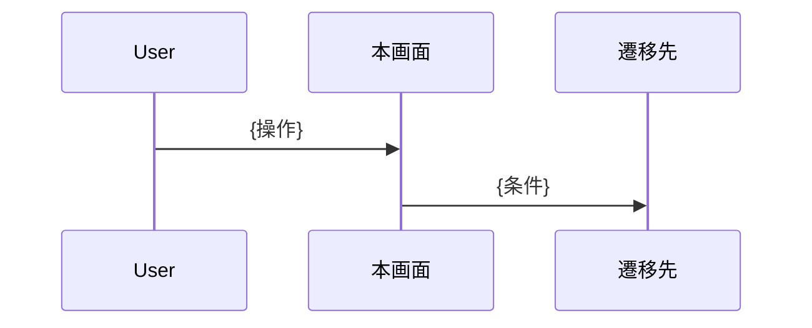

# SCR-{画面编号} {画面名}

| 項目 | 内容 |
|------|------|
| 画面编号 | SCR-{B-xx-xx-xx} |
| 要件来源（PPT） | `{文件名.pptx}` slide {n} / 注釈 {②④…} |
| 関連 | [API-{id}](../07_API設計書/API-{id}.md) · [親画面](./SCR-xxx.md) |
| UI 参照 | Figma / `05_UI設計/`（**見た目はこちら；本 MD 不写色・像素**） |
| 既存実装 | `{frontend/.../xxx.vue}` |
| 実装状態 | todo / wip / ✅ / ⏳ {未达 PPT 的项} |

## 1. 画面概要

| 项目 | 内容 |
|------|------|
| 目的 | {用户在此画面完成什么} |
| 入口 | {菜单路径 / 从哪一画面打开 / 打开条件} |
| 布局形态 | {一覧 / 全画面 / Modal / タブ} |
| 权限 | `{ACCESS_*}` |

## 2. 画面レイアウト（ASCII 或链 Figma）

```
┌─────────────────────────────────────────┐
│ {ヘッダー・ツールバー}                    │
├─────────────────────────────────────────┤
│ {主内容区}                               │
├─────────────────────────────────────────┤
│ {フッター・ボタン}                        │
└─────────────────────────────────────────┘
```

> 列宽、配色以 PPT/Figma 为准；此处只写 **结构** 与 **控件类型**。

## 3. 画面項目

| 项番 | 项目（ja） | 物理名/绑定 | 组件 | 读写 | 必须 | 校验 / 备注 |
|------|------------|-------------|------|------|------|-------------|
| 1 | {表示名} | `{field}` | `n-input` / … | R/W | ○ | {规则} |

> **Future 规约**：项番 >15 或行数很多时，大表放 Excel/Figma，MD 只保留摘要 + 链接。

## 4. 画面遷移



| 操作 | 遷移先 | 条件 |
|------|--------|------|
| {按钮} | SCR-{id} / 一覧 | {…} |

## 5. イベント・操作

| 操作 | 触发 | 调用 API | 请求要点 | 成功反馈 | 失败 |
|------|------|----------|----------|----------|------|
| {登録} | click | `{HTTP} {path}` | `{body 摘要}` | {toast / 遷移} | `{错误码}` |

## 6. バリデーション

| 项番 | 规则 | 时机 | messageKey |
|------|------|------|------------|
| 1 | {…} | blur / submit | `{CMPF…}` |

## 7. コンポーネント連携

| 方向 | 说明 |
|------|------|
| 親 → 子 | {props 业务含义} |
| 子 → 親 | {emit 业务含义} |

> 暴露给父画面的操作（保存、刷新等）在 **§11 実装詳細** 用业务语描述；函数名仅放 §11.2 実装対照。

## 8. i18n

| 键 | ja | en |
|----|----|-----|
| `data.{domain}.{key}` | {日文} | {English} |

## 9. PPT vs 现状（改修画面必填）

| PPT 要素 | PPT 要求 | 当前实现 | 冲突 | 计划 |
|----------|----------|----------|------|------|
| {操作列} | {…} | {…} | 是/否 | {…} |

## 10. 実装状態サマリ

| 要件项 | PPT | 设计 | 代码 | 备注 |
|--------|-----|------|------|------|
| {①} | ○ | ○ | ⏳ | {…} |

## 11. 実装詳細（開発時追記 · 必須）

> PPT/要件が粗い場合、**实装前または实装と同時**に本節を書く。  
> **写法**：[設計書記述規範](../../設計書記述規範.md) §3（目的/触发/输入/处理/输出/边界）。  
> 复杂全流程优先写入 `処理フロー詳細.md`，本节只写本画面相关摘要 + 链接。

### 11.1 {機能ブロック名}

**目的** — {…}

**触发** — {…}

**输入** — {业务数据，非变量名}

**处理**

1. {…}
2. {…}

**输出** — {…}

**边界** — {…}

→ 関連：BR-{xx} · AC-{xx} · [処理フロー詳細 §x](../処理フロー詳細.md)

### 11.2 実装対照（开发用・可选）

| 业务节 | 路径 |
|--------|------|
| {…} | `{frontend/...}` |
