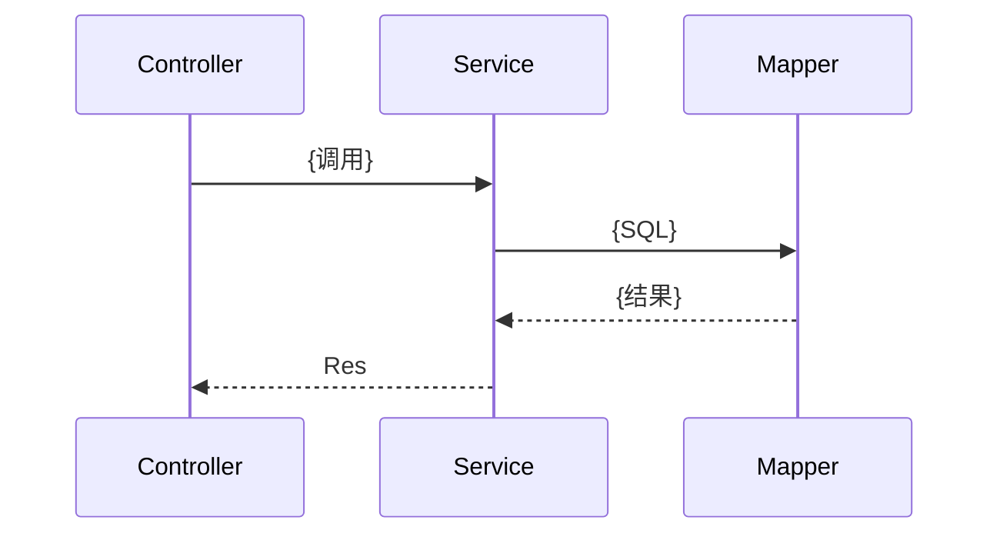

# API-{编号} {API 名称}

| 項目 | 内容 |
|------|------|
| API 编号 | API-{B-xx-xx-xx-xx} |
| HTTP | {GET / POST / PUT / DELETE} |
| Path | `/api/{path}` |
| Controller | `{类}#{方法}` |
| Service | `{类}#{方法}` |
| 契約 | [openapi.yaml](./openapi.yaml) |
| 画面 | [SCR-xxx](../06_画面設計書/SCR-xxx.md) |
| 実装状態 | todo / wip / ✅ |

> 主文档：[../詳細設計書.md §{n}](../詳細設計書.md)

## 1. 処理概要

{1～3 句：为何需要本 API、与既存 API 关系}

## 2. 入出力

> **OpenAPI 已定义的字段不在此重复**；仅写 openapi 未覆盖的说明。

### 2.1 请求

| 字段 | 必须 | 类型 | 说明 |
|------|------|------|------|
| `{field}` | ○ / △ | {type} | {…} |

### 2.2 响应

| 字段 | 类型 | 说明 |
|------|------|------|
| `{field}` | {type} | {…} |

### 2.3 ヘッダ / 权限

| 项 | 内容 |
|----|------|
| 认证 | Bearer（Keycloak） |
| 公司 | `UserAccesFilter.getCurrentCompanyId()` |
| 权限 | {注解 / 手动校验} |

## 3. ビジネスロジック

> **必守**：仅读本节应能理解端到端行为。禁止只写「详见 Service」。

### BL-00 总览

```
INPUT: {…}
OUTPUT: {…}
主流程: BL-01 → BL-02 → … → BL-0N
```

### BL-01 {步骤名}

| 条件 | 处理 | 失败 |
|------|------|------|
| {…} | {…} | `{错误码}` |

### BL-02 {步骤名}

{判断表、算式、分支}

```text
if (新规) {
  ...
} else {
  ...
}
```

## 4. DB 項目

### 4.1 取得（SELECT）

| 表 | 条件 |
|----|------|
| `{table}` | `{WHERE 摘要}` |

### 4.2 登録 / 更新

| 表 | 操作 | 字段 |
|----|------|------|
| `{table}` | INSERT / UPDATE | {列列举} |

## 5. エラー処理

| 错误码 | 条件 | 恢复 / 画面表现 |
|--------|------|-----------------|
| `{{{error_code_prefix}}xxxx-E}` | {…} | {…} |

## 6. 処理シーケンス



## 7. 使用 SQL（可选）

| ID | 说明 |
|----|------|
| SQL-01 | {动态 SQL / 手写脚本路径} |

## 8. 与其他 API / 批处理关系

| 关系 | 说明 |
|------|------|
| {Excel 取込} | {校验条件相同 / 复用方法名} |

## 9. テスト観点

| # | 场景 | 期待 |
|---|------|------|
| T1 | {正常系} | {…} |
| T2 | {重复 / 权限 / 排他} | `{错误码}` |

## 10. 実装詳細（開発時追記 · 必須）

> 写法：[設計書記述規範](../../設計書記述規範.md) §3。与画面联动见 [処理フロー詳細](../処理フロー詳細.md) 与 [SCR-xxx §11](../06_画面設計書/SCR-xxx.md)。

**目的** — {…}

**触发** — {…}

**处理**（服务器侧，业务步骤）

1. {…}
2. {…}

**输出** — {…}

**边界** — {…}

→ 関連 AC：AC-{xx}

### 10.1 実装対照（开发用・可选）

| 层 | 路径 |
|----|------|
| Controller | `{…}` |
| Service | `{…}` |
