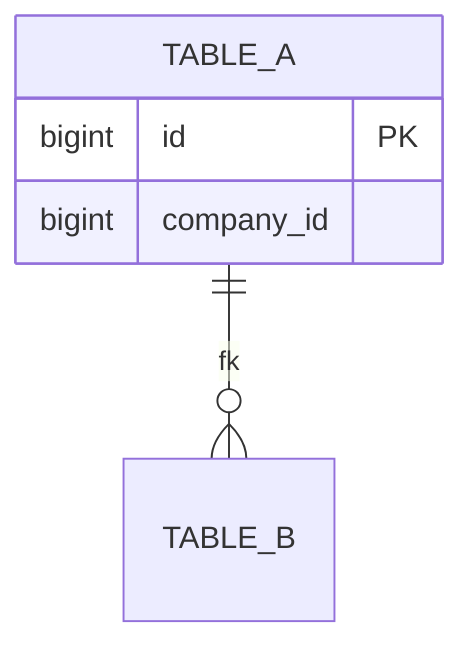

# {機能名} データモデル

| 項目 | 内容 |
|------|------|
| 版本 | 1.00 |
| 更新日 | YYYY-MM-DD |
| 关联 | [詳細設計書.md](./詳細設計書.md) §3 |

## 1. ER 关系（摘要）



> 完整 ERD 可链外部工具导出图；本 MD 以 **变更表** 为主。

## 2. 表定义

### 2.1 `{schema}.{table_name}`

| 列名 | 类型 | NULL | 默认 | 说明 |
|------|------|------|------|------|
| `id` | bigint | NO | serial | PK |
| `company_id` | bigint | NO | — | 会社 |
| `{new_col}` | {type} | YES | — | {说明} |

**索引 / 唯一约束**

| 名称 | 列 | 说明 |
|------|-----|------|
| {uk_…} | `{col1, col2}` | {业务唯一} |

**既存 Entity**：`{CfpXxxEntity.java}`  
**Mapper**：`{XxxMapper.java}` / `mapper/dbo/{Xxx}.xml`

## 3. 迁移脚本

| 脚本 | 环境 | 说明 |
|------|------|------|
| `carbonapi/src/main/resources/sql/{name}.sql` | dev/stg/prd | {ALTER / CREATE} |

```sql
-- 示例（勿直接执行本模板）
-- ALTER TABLE dbo.{table} ADD COLUMN IF NOT EXISTS {col} {type} NULL;
```

## 4. 数据迁移 /  backfill

| 场景 | 策略 |
|------|------|
| 新列 NULL | {読込时补全 / 批处理 backfill} |

## 5. 与 OpenAPI / DTO 对应

| DB 列 | Entity 字段 | API/DTO 字段 |
|-------|-------------|--------------|
| `{col}` | `{getter}` | `{dtoField}` |
