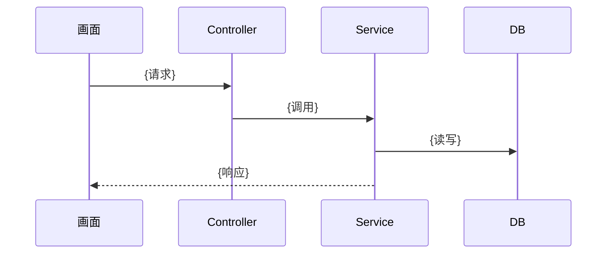
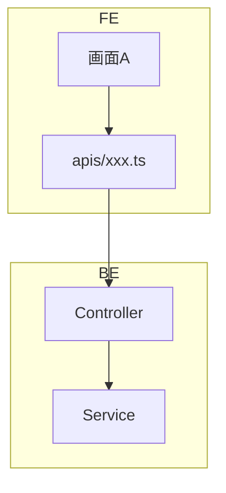

# {機能名} 詳細設計書

| 項目 | 内容 |
|------|------|
| 文档编号 | `{例：B04-G-xxx-DD}` |
| API 编号 | `{例：API-B-xx-xx-xx}` |
| 画面编号 | `{例：SCR-B-xx-xx-xx}` |
| 版本 | 1.00 |
| 作成日 | YYYY-MM-DD |
| 更新日 | YYYY-MM-DD |
| 要件参照 | `{要件定義書 / PPT / xlsx 文件名}` |
| 機能目录 | `docs/{機能}/` |
| 关联 | [{他機能}](../{他機能}/詳細設計書.md)（若无则 —） |
| UI 参照 | `05_UI設計/` 或 Figma URL（若有） |

**本文档为 {機能} 开发用主设计书**。拆分：[06 画面](./06_画面設計書/) · [07 API](./07_API設計書/)。

**処理フロー**：逐步数据流转见 [処理フロー詳細.md](./処理フロー詳細.md)（写法：[設計書記述規範](../ai-native/設計書記述規範.md)）。本文保留 BR 规则与索引。

---

## 1. 背景与目的

### 1.1 要件摘要

| # | 变更 / 功能 | 目标 |
|---|-------------|------|
| ① | {变更点} | {用户价值 / 减少工数} |
| ② | {…} | {…} |

### 1.2 不在范围内

| 项 | 理由 |
|----|------|
| {例：他模块 API 变更} | {引用别文档} |

### 1.3 改修前挙動（改既有功能必填）

> 以 HEAD 代码为准。本次要改的格子写「変更」并链到 BR；其余格子保持不变，由单体 Case 出回归 case。

| 对象 / 特殊值 | {图表・画面・API ①} | {②} | 前端 / 后端 | 本次 |
|---------------|---------------------|-----|-------------|------|
| 分组 / 合并 | {…} | {…} | {前端按名称合并 等} | 不变 |
| 过滤 / 排序 | {…} | {…} | | 不变 |
| null / 空字符串 / 只有空格 | {…} | {…} | | 不变 |
| 0 值 | {…} | {…} | | 不变 |
| 汇总词・多语言 | {…} | {…} | {后端写死文言 等} | 不变 |

### 1.4 实现原则

| 原则 | 说明 |
|------|------|
| minimal diff | {复用哪些 Service / 组件} |
| 校验单一来源 | {画面与取込 / 批处理对齐方式} |
| 权限与公司隔离 | 与既存 `{Service}` 一致 |

---

## 2. 功能域设计（按域拆小节）

> 每个主要业务能力一节（例：复制、导入、报表生成）。复杂功能可拆成 §2、§3…

### 2.1 {子功能名} — 概要

| 层 | 位置 |
|----|------|
| API | `{HTTP} {path}` |
| Service | `{类#方法}` |
| UI | `{vue 路径}` |

### 2.2 処理シーケンス

### 2.3 业务规则表

| 规则 ID | 条件 | 结果 | 错误码 |
|---------|------|------|--------|
| BR-01 | {…} | {…} | `{CMPFxxxx-E}` |

### 2.4 复制 / 共享 / 不处理范围（若适用）

| 对象 | 处理 | 备注 |
|------|------|------|
| {实体/字段} | ○ / × | {…} |

---

## 3. データモデル（摘要）

> 完整表定义见 [08_データモデル.md](./08_データモデル.md) 或各 API MD 的 DB 項目。

### 3.1 变更一览

| 表 | 变更 | 脚本 |
|----|------|------|
| `{schema}.{table}` | {ADD COLUMN / 新表} | `carbonapi/.../sql/{name}.sql` |

### 3.2 字段语义（新字段）

| 字段 | 类型 | 语义 |
|------|------|------|
| `{column}` | {type} | {业务含义、编号规则} |

### 3.3 既存数据迁移

| 情况 | 处理 |
|------|------|
| {NULL / 旧数据} | {默认値、読込时补全} |

### 3.4 実装状態

| 层 | 状态 |
|----|------|
| SQL | todo / ✅ |
| Entity / Mapper | todo |
| Service | todo |
| 前端 | todo |

---

## 4. 校验与错误码对照（若与取込/他路径共用）

| 触发 | 规则摘要 | 画面 | 取込/批处理 | 错误码 |
|------|----------|------|-------------|--------|
| 登録 | {…} | ○ | ○ | `{…}` |

---

## 5. 系统构成

---

## 6. API 一览

| # | 名称 | HTTP | Path | 文档 |
|---|------|------|------|------|
| 1 | {名称} | {GET/POST/PUT/DELETE} | `{path}` | [API-xxx](./07_API設計書/API-xxx.md) |

> 契约正本：`07_API設計書/openapi.yaml`

---

## 7. 画面一览

| 画面 | 文档 | 变更类型 | 要件来源（PPT） |
|------|------|----------|-----------------|
| {名称} | [SCR-xxx](./06_画面設計書/SCR-xxx.md) | 新規 / 改修 | slide {n} |

---

## 8. 权限

| 操作 | 权限常量 |
|------|----------|
| 参照 | `ACCESS_R_…` |
| 更新 | `ACCESS_U_…` |
| API | `UserAccesFilter.getCurrentCompanyId()` |

---

## 9. 验收

[验收标准.md](./验收标准.md) — Human 批准 gate。

---

## 10. 要確認事項

> 影响 BR / AC 的 Q 未回答时，本设计书不得标为定稿。编号不复用。

| Q | 问题 | 选项 | 影响 | 暂定方针 | 状态 |
|---|------|------|------|----------|------|
| Q-1 | {…} | A {…} / B {…} | {选 B 时要改哪些} | A（BR-xx） | 未回答 / 回答済（YYYY-MM-DD）：{回答} / N/A |

### 10.1 已知风险

| # | 项 | 跟踪 |
|---|-----|------|
| R1 | {…} | {…} |

---

## 11. 参照既存代码

| 用途 | 路径 |
|------|------|
| Controller | `carbonapi/.../{Controller}.java` |
| Service | `carbonapi/.../{Service}.java` |
| 画面 | `frontend/src/views/...` |
| API | `frontend/src/apis/...` |

---

## 附录 A — 单体模式（小功能可选）

若功能简单，可不建 `06/` `07/` 子目录，而将 §6 §7 内容写入单一 `機能設計書.md`：

- **§3 画面设计** = 本文 §7 + 各画面項目表
- **§4 API 设计** = 本文 §6 + 各 API 的 BL 章节（无 openapi 时在 MD 内写全请求/响应）

新功能仍须使用 `docs/{機能}/` 文件夹。
