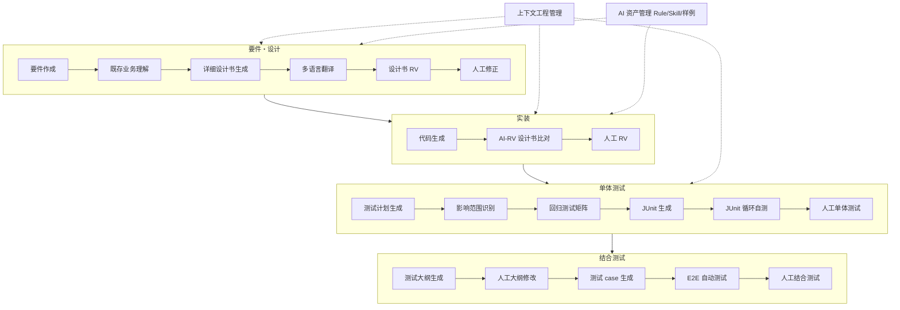

# AI Native 開発フロー（{{system_name}}）

> **约束以 `.cursor/rules/workflow.mdc` 为准。** 本文为详细说明与图示。
>
> **本地专用**：本文件及 `docs/`、`.cursor/`、`AGENTS.md` 等不提交到甲方仓库（见 `AGENTS.md` §本地专用）。

## 团队分工（Grok Bot 群「碳排放小组」）

| 环节 | 担当 | 产出（均在本地） |
|------|------|------------------|
| 需求分发・进度管理 | Grok Bot | 按需求分别管理进度和 Q 编号 |
| 设计书 | 碳排放-设计书 | `docs/{機能}/` MD 原稿 + 导出 xlsx |
| 单体 Case | 碳排放-单体case | `docs/{機能}/単体テスト項目_{機能}.xlsx` |
| 实装・JUnit・自测 | 碳排放-coder | 代码改动（一需求一分支） |
| RV | 碳排放-reviewer | RV 结果（对照本地设计书） |
| 决策・最终 RV・提交 | Human | 只提交业务代码 |

> **不使用 Grok Bot 时**（只用 Cursor 开发）：上表各角色全部由 Cursor Agent 自己承担（可按 `orchestrator.md` 分阶段 / 分 subagent），流程、门禁、产出物不变。

{{ex_flow_policy_ref}}每个环节 **人工确认结果**，Agent 负责生成与执行，Human Lead 负责决策与最终 RV。

## 文档模板

| 阶段 | 模板 |
|------|------|
| 写设计书 | [验收标准_模板.md](./验收标准_模板.md) |
| 单元测试 | [回归テスト矩阵_模板.md](./回归テスト矩阵_模板.md) |
| 联调验收 | [結合テスト大纲_模板.md](./結合テスト大纲_模板.md) |
| PR | `.github/pull_request_template.md`（本地自查用，不贴进甲方 PR） |



## 0. 准备（每次功能开发前）

| 步骤 | 担当 | 产出 |
|------|------|------|
| 确认 `docs/{機能}/` 是否存在 | Human / Orchestrator | 文件夹 + README + 验收标准 |
| 检索既存代码与类似功能 | Feature Agent | 既存逻辑摘要（主键、校验、错误码） |
| 加载 Rule + Skill | 自动 | `.cursor/rules/`、[skills/README.md](./skills/README.md) |

**Stop**：未理解既存逻辑前，不开始写业务代码。

## 1. 要件定义 / 基本设计

| 步骤 | Agent 能力 | Human |
|------|------------|-------|
| 要件整理 | 从 PPT/xlsx/口头需求生成要件摘要 | 确认范围 |
| 验收标准 | 填 `验收标准_模板.md` | **批准** |
| 系统架构 / 数据模型 | 参照现有 module、表、API 风格 | 确认边界 |

## 2. 详细设计

| 步骤 | Agent | Human |
|------|-------|-------|
| 06 画面 / 07 API MD + OpenAPI | Docs Agent | — |
| 与既存代码一致性校验 | Review Agent | 设计书 RV |
| ja/en 文案草案 | Feature + i18n Rule | 确认术语（不需 zh） |

**Stop**：设计书 RV 未通过 → 不进入实装。

## 3. 实装

| 步骤 | Agent | Human |
|------|-------|-------|
| 后端 / 前端 / locale | Feature Agent | — |
| AI-RV | Review Agent（`review.mdc`） | — |
| PR | — | **人工 RV**（PR 说明只写业务内容，不含 RV 结果 / BR・AC 编号 / `docs/` 路径） |

## 4. 单体测试

| 步骤 | Agent | Human |
|------|-------|-------|
| 回归矩阵 | 填 `回归テスト矩阵_模板.md` | 确认 |
| JUnit + `{{build_cmd}} … -DskipTests=false` | Test Agent | 边界 case |

## 5. 结合测试

| 步骤 | 现状 | 操作 |
|------|------|------|
| 大纲 | 模板化 | `結合テスト大纲_模板.md` |
| E2E 自动 | `e2e/` Playwright + MCP | `cd e2e && npm test` |
| MagicPod | 遗留 | 逐步迁移到 `e2e/tests/` |
| 人工确认 | 必须 | 本地留存联调结果（不贴进甲方 PR） |

## 6. 上下文工程

- 代码变更 → 同步 `docs/{機能}/`
- convention → `.cursor/rules/`（Cursor）/ `AGENTS.md`（Codex）
- 复盘 → 以 diff **提议**更新 rules 或本目录，用户同意后再写入

## 快速命令

```bash
{{build_cmd}} -pl {{main_module}} -am test -DskipTests=false
cd {{frontend_module}} && npm run build
cd e2e && npm test
```
