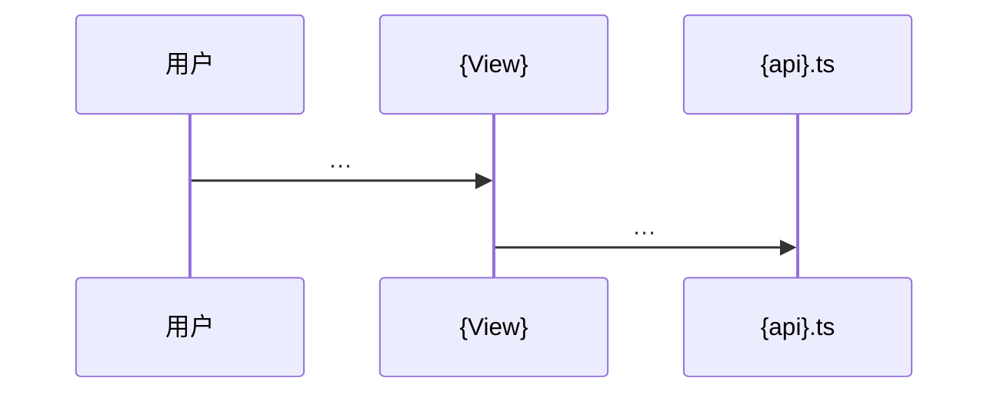
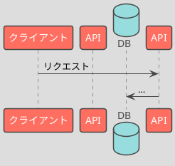

# Markdown 設計書 Templates

**保存位置**：一律在 `docs/{機能フォルダ}/` 下。写前先建目录，见 [future-06-07.md](future-06-07.md)。

---

## H. 機能文件夹 README（新建功能时第一份）

路径：`docs/{機能フォルダ}/README.md`

```markdown
# {機能名}

| 項目 | 内容 |
|------|------|
| 文档编号 | … |
| API 编号 | … |
| 画面编号 | … |
| 对象范围 | **仅** … |

## 文档一覧

| 路径 | 说明 |
|------|------|
| [機能設計書.md](./機能設計書.md) | 全栈単文件（若采用模板 A） |
| [06_画面設計書/](./06_画面設計書/) | 画面 |
| [07_API設計書/](./07_API設計書/) | API |
```

---

## A. 機能設計書（単文件）

路径：`docs/{機能フォルダ}/機能設計書.md`  
§3 = **06**，§4 = **07**（无 openapi 时写全量参数表）。

```markdown
# {機能名} 機能設計書

| 項目 | 内容 |
|------|------|
| 文档编号 | {DOC-ID} |
| API 编号 | {API-ID} |
| 画面编号 | {SCR-ID} |
| 版本 | 1.00 |
| 作成日 | {YYYY-MM-DD} |
| 对象范围 | **仅** {一句话} |
| 機能目录 | `docs/{機能フォルダ}/` |
| UI 参照 | `./05_UI設計/…` 或 Figma URL |

---

## 1. 背景与目的
（略：1.1 背景 / 1.2 目的 / 1.3 不在范围内）

---

## 2. 系统构成
（Mermaid flowchart + 2.1 源码表 + 2.2 URL 前缀）

---

## 3. 画面设计（06_画面設計書 · {SCR-ID}）

> 見た目・レイアウトは **UI 参照** のみ。本章写行为与 API 连携。

### 3.1 画面概要
- **入口**：菜单位置、打开条件

### 3.2 画面遷移
（Mermaid 或「详见 UI 参照」）

### 3.3 画面項目
| 项番 | 项目 | 控件/类型 | 必须 | 说明 |
|------|------|-----------|------|------|
| 1 | … | … | ○ | … |

> 項目が多い場合：一覧は Figma/Excel、本章只写与 API・校验相关的项。

### 3.4 イベント・操作
| 操作 | トリガー | 调用 API | 参数/FormData | バリデーション | 结果/遷移 |
|------|----------|----------|---------------|----------------|-----------|

### 3.5 画面操作流


### 3.6 コンポーネント連携
| 方法/事件 | 用途 |
|-----------|------|

### 3.7 i18n
| 键 | 用途 |
|----|------|

---

## 4. API 设计（07_API設計書 · {API-ID}）

> 若有 `openapi.yaml`：契約见该文件；本章只写処理・BL・DB（不重复参数表）。

### 4.1 API 一览
| 项番 | API-ID | 名称 | HTTP | URL |
|------|--------|------|------|-----|

### 4.2 API-1：{名称}

#### 4.2.1 契約
- OpenAPI：`openapi.yaml` → `{path}`（无 openapi 则写请求/响应表）

#### 4.2.2 処理概要
1. …
2. 错误：`CMPFxxxx-E` → …

#### 4.2.3 処理シーケンス
```mermaid
sequenceDiagram
  …
```

#### 4.2.4 ビジネスロジック
（伪代码或算式）

#### 4.2.5 DB 項目
**取得**
- 表.列 …
- 抽出条件：…

**登録** / **更新**
- …

#### 4.2.6 応答項目の由来（複表 JOIN 时）
| Parameter | Description | Settings | Note |
|-----------|-------------|----------|------|

#### 4.2.7 使用 SQL
SQL-01, …

---

## 5. 数据・DB / 6. 校验 / 7. 非功能 / 8. 测试
（同前）
```

---

## F. 06_画面設計書（Future 拆分 · 单画面）

路径：`docs/{機能フォルダ}/06_画面設計書/SCR-{id}_{名称}.md`

```markdown
# SCR-{id} {画面名}

| 項目 | 内容 |
|------|------|
| 画面编号 | SCR-{id} |
| 版本 | 1.00 |
| 作成日 | YYYY-MM-DD |
| UI 参照 | [05_UI設計](../05_UI設計/…) 或 Figma URL |

---

## 1. 画面概要
- **目的**：
- **入口**：

## 2. 画面遷移


## 3. 画面項目
| 项番 | 論理名 | 物理名/绑定 | 控件 | 必须 | 初期値 | 备注 |
|------|--------|-------------|------|------|--------|------|

> 数十項目以上：本节写「項目定義は UI 参照」+ 仅列与 API/校验相关项。

## 4. イベント・操作
| # | 操作名 | トリガー | API-ID | 请求概要 | バリデーション | 成功時 | 失敗時 |
|---|--------|----------|--------|----------|----------------|--------|--------|

## 5. バリデーション
| 规则 | 时机 | messageKey |
|------|------|------------|

## 6. コンポーネント連携
| 组件 | emit / expose | 说明 |
|------|---------------|------|

## 7. 関連 API
| API-ID | 用途 |
|--------|------|
| API-01 | … |

## 8. i18n
| key | 画面上的位置 |
|-----|--------------|
```

---

## G. 07_API 設計書（Future 拆分 · OpenAPI + プログラム設計）

路径（均在 `docs/{機能フォルダ}/` 下）：
- `07_API設計書/openapi.yaml` — 契約
- `07_API設計書/API-{id}_{名称}.md` — 各 API 処理設計

### G-0. openapi.yaml（头部说明，写入 README 或 yaml 注释）

```yaml
# {機能名} API — {API-ID}
# 設計書: docs/{機能}/07_API設計書/API-*.md
openapi: 3.0.3
info:
  title: …
  version: 1.0.0
paths:
  /api/...:
    get:
      summary: …
      parameters: …
      responses: …
```

### G-1. 单 API プログラム設計 MD

```markdown
# API-{id} {API 名称}

| 項目 | 内容 |
|------|------|
| API 编号 | API-{id} |
| HTTP | GET / POST / … |
| Path | `/api/...` |
| OpenAPI | `openapi.yaml#/paths/...` |

---

## 1. 処理概要
- **目的**：
- **触发**：画面 SCR-… / バッチ / 外部 I/F

1. 步骤一 …
2. 步骤二 …
3. 错误时 …

## 2. 処理シーケンス

（或用 Mermaid sequenceDiagram）

## 3. ビジネスロジック

> **完整度要求**：读者仅读本节即可理解 API 行为。须含 BL-00 总览 + 按执行顺序的 BL-01…；每块含判断表/算式/数据转换规则。禁止仅列类名或「详见代码」。详见 skill [API 业务逻辑完整度要求](../SKILL.md#api-业务逻辑完整度要求必守)。

### BL-00 总览

```txt
INPUT: …
OUTPUT: …

1. …
2. …
```

### BL-01 {阶段名}

**位置**：`ClassName.methodName`

#### BL-01.1 {子规则名}（可选）

| 条件 | 结果 |
|------|------|
| … | … |

```txt
IF … THEN …
ELSE …
```

### BL-02 …
```

## 4. DB 項目
### 4.1 取得
- `m_xxx`.列名
- 抽出条件：…

### 4.2 登録
- `t_xxx`.列名 = …

### 4.3 更新
- …

## 5. 応答項目の由来（openapi と併用・JOIN 応答時）
| Parameter | Description | Settings | Note |
|-----------|-------------|----------|------|

## 6. エラー処理
| Pattern | Description | messageKey / HTTP | recovery |
|---------|-------------|-------------------|----------|

## 7. 使用 SQL
| 编号 | 用途 |
|------|------|
| SQL-01 | … |

## 8. 関連画面
| SCR-ID | 操作 |
|--------|------|
```

---

## B. API 設計書のみ

目录：`docs/{機能フォルダ}/07_API設計書/`

1. `openapi.yaml` 一览  
2. 每个 endpoint 一份 **G-1**  
3. 文末：メッセージ定義表（Future 样本格式）

```markdown
## メッセージ定義
| 識別子 | レベル | ステータス | メッセージ | コメント |
|--------|--------|------------|------------|----------|
```

---

## C. 画面設計書のみ

目录：`docs/{機能フォルダ}/06_画面設計書/`

使用模板 **F**；§7 関連 API 必须填满。

---

## D. 校验一覧（补充）

路径：`docs/{機能フォルダ}/{对象}_校验一覧.md`（与主設計書同機能文件夹）

---

## E. 変更履歴

（ unchanged）

---

## 布局选择

| 场景 | 先建目录 | 模板 |
|------|----------|------|
| 新功能 | `docs/{機能}/` + **H** README | **A** 或 **F+G** |
| 全栈単文件 | `docs/{機能}/機能設計書.md` | **A** |
| Future 拆分 + OpenAPI | `docs/{機能}/06_` `07_` | **F** + **G** |
| 只改画面 | 已有 `docs/{機能}/` | **F** |
| 只改 API | 已有 `docs/{機能}/` | **G-1** |
